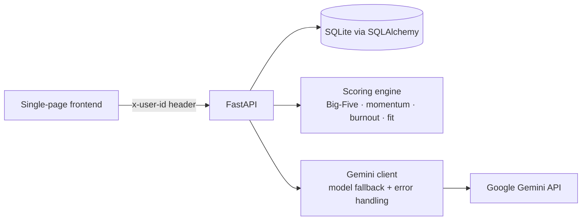

<div align="center">

# 🧭 MENTAURI

**A Gemini-powered growth strategist for Indian college students.**

Maps your personality and skills to real opportunities, finds your skill gaps, simulates career paths,
and catches burnout early.

[](https://mentauri.onrender.com/)


**[▶ Open the live demo](https://mentauri.onrender.com/)**

</div>

---

## The problem

Students in India are surrounded by options (hackathons, fellowships, research internships, competitive exams,
scholarships) but get very little guidance on which ones fit *them*. Most advice is generic, assumes a tech career,
and ignores energy, burnout and how a person actually works.

## What MENTAURI does

| Feature | What it gives you |
|---|---|
| **Personality assessment** | A 35-question Big-Five questionnaire plus learning-style and risk-appetite items. Gemini turns the scores into strengths, blind spots, a personal "operating manual" and a "native habitat" (the kind of team or role you thrive in). |
| **Opportunity Atlas** | 34 curated opportunities across fields: hackathons, GSoC, research internships, UPSC and State PCS, CAT, GATE, CLAT, CA, consulting, scholarships and more. Each gets a fit score from your branch, college, target role and skills. |
| **Skill-gap analysis** | The 8–12 highest-leverage missing skills, three starter projects with hour estimates, and a 12-week roadmap, tailored to your target field. |
| **Atlas Simulator** | Three realistic paths to a goal role (steps, outcomes, risks, exit ramps) and a comparison that says which suits you. |
| **Daily check-ins** | Energy, productivity, sleep and exercise feed a **momentum score** and a **burnout band** (green / yellow / red), with streaks. |
| **Mentaur chat** | A mentor-style assistant that knows your profile and recent state. It replies in English or Hinglish and points to real Indian helplines if things look serious. |
| **To-dos** | Small, concrete weekly tasks generated for your actual goal (a DSA set for one student, a CAT DILR set for another). |
| **Imports** | Pull skills and projects from a resume PDF or your public GitHub repos. |
| **Leaderboard** | Momentum ranking with privacy-preserving display names. |

> The recommendations are not tech-only. A student targeting UPSC, CAT or NEET-PG gets paths, tasks and
> opportunities for that field.

## How it works



**Stack:** Python 3.12 · FastAPI · SQLAlchemy · SQLite · `google-genai` · httpx · PyPDF2 · single-file HTML/JS frontend in `static/`.

### Design choices worth knowing

- **Bring your own key.** Each visitor pastes their own free Gemini key, stored against their own session. One person's
  usage (or Google's daily quota) can't lock everyone else out.
- **Model fallback chain.** Requests try an ordered list of pinned Gemini models. The `-latest` alias is deliberately
  avoided because it can silently switch to a preview model with tighter limits.
- **Honest failure handling.** Quota errors (429), timeouts and Google-side overloads (503) each get their own message,
  so a busy Gemini is never reported as "invalid API key". Every AI feature also has a fallback response, and the
  non-AI parts (dashboard, atlas, tasks, streaks) keep working.
- **Whole-word field matching.** Branch and goal text is matched to fields using word boundaries, so short keywords
  like `ai` or `ca` don't false-match inside words like "Mains" or "vacation".
- **Rule-based wellbeing.** The burnout band comes from transparent rules over sleep, energy trend, exercise and
  productivity. It is a nudge, not a diagnosis.

## Run it locally

```bash
git clone https://github.com/dragunxwho13/Mentauri.git
cd Mentauri
pip install -r requirements.txt
uvicorn main:app --reload
```

Open **http://127.0.0.1:8000**, create a session, then add a free key from
[aistudio.google.com/apikey](https://aistudio.google.com/apikey) in **Settings**.

For solo development you can skip the in-app step by setting `MENTAURI_DEV_PREFILL_KEY` in a `.env` file.
It is opt-in and off by default.

**Docker:**

```bash
docker build -t mentauri .
docker run -p 8080:8080 mentauri
```

**Deploy:** `render.yaml` is included for Render, and the Dockerfile reads `PORT` at runtime.

## API

Interactive docs are served at `/docs` (FastAPI's built-in Swagger UI).

| Area | Endpoints |
|---|---|
| Session | `POST /api/start` · `GET/PATCH /api/me` · `GET/POST /api/settings` |
| Assessment | `GET /api/assessment/questions` · `POST /api/assessment/answer` · `POST /api/assessment/finish` |
| Profile data | `/api/skills` · `/api/projects` · `/api/goals` · `/api/todos` |
| Intelligence | `GET /api/opportunities` · `POST /api/skills/analyze` · `POST /api/simulate` · `GET /api/insights/today` |
| Wellbeing | `POST /api/checkin` · `GET /api/momentum/history` · `GET /api/streak` |
| Chat & import | `POST /api/chat` · `POST /api/import/resume` · `POST /api/import/github` |
| Social | `GET /api/leaderboard` |

## Limitations

- **Not a validated psychometric.** Big-Five scoring is a simplified implementation for guidance, not a clinical or research instrument.
- **Not medical advice.** The burnout band is heuristic. For real distress, talk to a person.
- **Prototype-grade accounts.** Sessions are identified by a generated user id (no passwords), so don't store anything sensitive.
- **Ephemeral demo data.** The hosted free-tier instance resets its filesystem on redeploy, so demo accounts don't persist. The first request after idle may be slow while the server wakes.
- **Curated, not live.** The opportunity list is a hand-curated seed. Deadlines are annual patterns, so always confirm on the official site.
- **AI can be wrong.** Gemini output is guidance. Verify programme details before acting on them.

---

<div align="center">
<sub>Built by <a href="https://github.com/dragunxwho13">Aniket Khuntia</a> · Prototype</sub>
</div>
